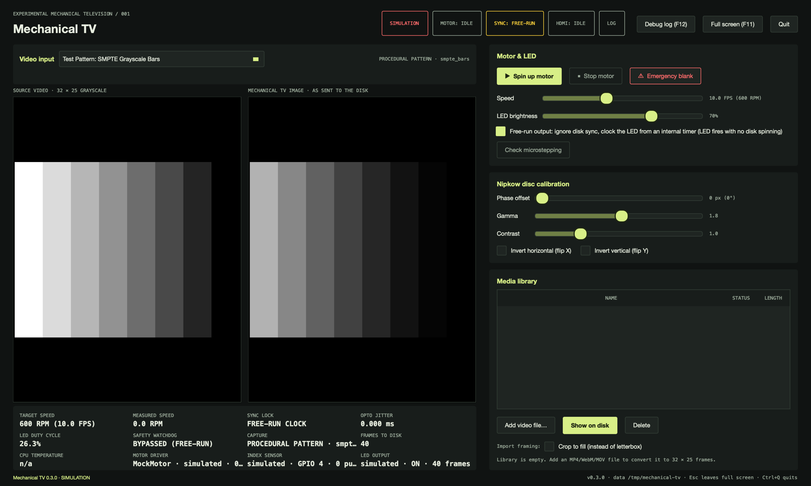

# Mechanical TV

A Raspberry Pi 4 mechanical television after [bitluni's design](https://github.com/bitluni/MechanicalTV):
an HDMI picture scaled to 32 × 25 pixels, flashed onto a 3 W LED behind a spinning Nipkow disk, one
revolution per frame.

**Version 0.3.0 is a C++ desktop application** (`mechanical-tv`) that runs on the Pi's own display.
It replaces the Python app and its web interface. The timing core was redesigned, not just
translated, to fix the start-up stall and the sync that never held. [docs/DIAGNOSIS.md](docs/DIAGNOSIS.md)
explains both and lists what to check on the bench.



## What it does

- **Live HDMI** from a TC358743 HDMI-to-CSI-2 adapter (GeeekPi/52Pi, Waveshare, Geekworm) on the
  CAMERA port. Raw UYVY frames are read in-process from the driver's buffers, with no encoding or
  decoding anywhere, and every frame is converted (about 2 ms). The app loads the EDID and locks
  the timings itself. USB UVC dongles work through FFmpeg.
- **Phase-locked LED output.** Every revolution is anchored to the kernel timestamp of the disk's
  index pulse and emitted by a realtime thread on an isolated CPU core. It goes out either as an
  SPI DMA bitstream (0.5 µs resolution) or bit-banged GPIO.
- **Motor control** for an A4988-style STEP/DIR driver on the Pi's hardware PWM (or the Adafruit
  Motor HAT). The start is gentle: enable, settle, then a jerk-limited S-curve from a crawl. Stall
  and slip detection stop the motor and say why. A microstep self-test checks the driver's jumpers.
- **Console:** input and output previews, telemetry, motor and LED controls, free-run output for
  bench tests, Nipkow calibration (phase, gamma, contrast, flips), media library, and a debug log
  window with a rotating log file.
- **Test patterns:** SMPTE bars, ramps, aperture grid, rotating bar, pulse, checkerboard, sweeping
  column and row, and a moving diagonal.
- **Media library:** add video files from local storage; they are converted in the background to
  32 × 25 frames at 10 fps.

## Install on the Pi

```bash
git clone https://github.com/andrewfrangella/MechanicalTV.git mechanicaltv
cd mechanicaltv                             # until the C++ port is merged: git checkout cpp-port
sudo bash install.sh                        # LED on GPIO 21 (original wiring)
sudo MTV_LED_OUTPUT=spi bash install.sh     # or: LED on SPI0 MOSI, GPIO 10 / pin 19 (more precise)
sudo reboot
```

The installer builds the app on the Pi, runs its tests, and installs it with a desktop icon, a menu
entry and autostart. It also applies the boot and realtime settings. Details:
[docs/INSTALL.md](docs/INSTALL.md).

## Develop on a computer

```bash
cmake -S . -B build -DCMAKE_BUILD_TYPE=Debug     # macOS: add -DCMAKE_PREFIX_PATH="$(brew --prefix qtbase);$(brew --prefix sqlite)"
cmake --build build -j
QT_QPA_PLATFORM=offscreen ./build/mtv_tests      # 57 test cases on macOS, 60 on Linux
./build/mechanical-tv --mock-hardware            # simulated motor, sensor and LED
```

Needs CMake 3.16+, a C++20 compiler, Qt 6 Widgets (5.15 also builds) and SQLite. FFmpeg is needed
for the library and its tests.

## Documentation

| Document | Contents |
| --- | --- |
| [DIAGNOSIS.md](docs/DIAGNOSIS.md) | The stall, the sync problem and the H.264 question: causes, fixes, bench checklist |
| [LOCAL_APP.md](docs/LOCAL_APP.md) | The console: options, keys, screen, free-run, microstep check, debug log |
| [USER_GUIDE.md](docs/USER_GUIDE.md) | Everyday use, calibration, library, troubleshooting |
| [HARDWARE.md](docs/HARDWARE.md) | Parts, wiring (A4988, sensor, LED, HDMI adapter, HAT), timing, safety |
| [INSTALL.md](docs/INSTALL.md) | Installer, boot settings, HDMI setup, every setting |
| [ARCHITECTURE.md](docs/ARCHITECTURE.md) | Threads, one revolution step by step, motor, capture, what changed from Python |
| [VALIDATION.md](docs/VALIDATION.md) | Tests and the on-Pi bring-up checklist |
| [PROJECT_PLAN.md](docs/PROJECT_PLAN.md) | Status and milestones |
| [research/](docs/research/README.md) | Research notes behind the diagnosis and design |
| [AGENTS.md](AGENTS.md) | Guide for AI agents and contributors working on the code |

## Attribution

Disk geometry, pixel mapping and the overall concept are by
[bitluni](https://github.com/bitluni/MechanicalTV). This repository is an independent Raspberry Pi
implementation. Vendored: doctest (MIT) and nlohmann/json (MIT) in `third_party/`.
