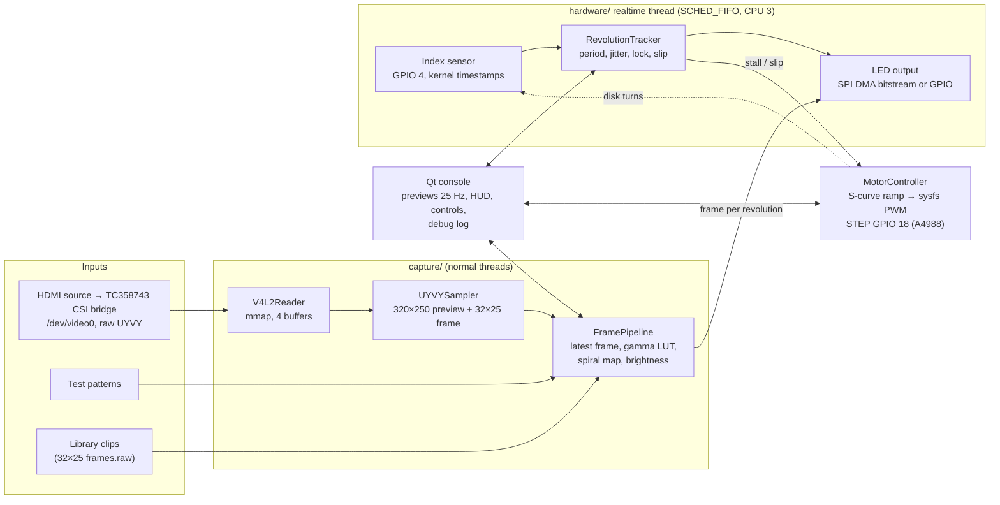

# Architecture

Mechanical TV 0.3 is one C++20 desktop application, `mechanical-tv`, running on a Raspberry Pi 4.
It replaces the Python app of versions 0.1 and 0.2 and its web interface. Everything runs in one
process: Qt for the window, plain threads for capture and hardware, and one realtime thread for the
disk.

## Source layout

| Directory | Contents |
| --- | --- |
| `src/mtv/common/` | Constants, frame types, logging (rotating file + listener), environment, subprocesses, realtime helpers (`rt.h`), system facts |
| `src/mtv/capture/` | Test patterns, gamma LUT, UYVY sampler, V4L2 reader, CSI bridge control (EDID and DV timings by ioctl), FFmpeg fallback, library clip source, `FramePipeline` |
| `src/mtv/hardware/` | Linux device wrappers (`linux_hw.h`: GPIO cdev v2, `/dev/gpiomem`, sysfs PWM, spidev, i2c-dev), motor drivers and `MotorController`, index sensor and `RevolutionTracker`, LED outputs, `RealtimeController` |
| `src/mtv/engine/` | SQLite media library with FFmpeg conversion, `Studio` (owns everything, conversion worker, import, health) |
| `src/mtv/console/` | Qt Widgets console, debug window, frame view, command line and `--check` report |
| `tests/` | doctest suite (`mtv_tests`): every module, including the window off-screen |
| `edid/` | EDID files loaded into the TC358743 (`packaging/make-edid.py` regenerates them) |
| `packaging/` | Desktop entry, icon, boot-time hardware unit, EDID and test-clip tools |
| `third_party/` | doctest 2.4.11, nlohmann/json 3.11.3 (single headers) |

## Threads

| Thread | Scheduling | Work |
| --- | --- | --- |
| `realtime-led` | SCHED_FIFO 60, pinned to CPU 3, memory locked | Waits on the index sensor; per edge: statistics, stall/slip check, then emits one revolution on the LED. Also the free-run clock and the LED interlock. Lives for the whole run. |
| `motor-rate` | normal | Every 5 ms advances the S-curve and writes the PWM period (A4988). The HAT uses `motor-stepper` (SCHED_FIFO 50) and steps by I2C. |
| `hdmi-capture-worker` | normal | EDID/timings, dequeue every frame, convert, requeue; reopen on failure. |
| `test-pattern-worker`, `library-clip-worker` | normal | 10 fps frame generation. |
| `conversion-worker` | normal | FFmpeg conversion of queued imports, only while the disk is not spinning. |
| `console-actions` | normal | Runs operator actions (start, stop, source change, microstep check) so the window never blocks. |
| GUI | normal | 25 Hz preview repaint, HUD every second tick, log drain. |

Frames pass between threads as `std::shared_ptr<const Frame>` copied under a very short lock, so
nothing on the realtime path waits for a slow operation. Switching sources, which can take seconds
while the HDMI worker exits, holds no lock that the realtime thread needs.

## One revolution

1. The index sensor's rising edge raises a GPIO interrupt. The kernel stores CLOCK_MONOTONIC in
   the hard-IRQ handler and queues the event.
2. `realtime-led` wakes (tens of µs later on an isolated core) and reads the event with its
   timestamp `T`.
3. `RevolutionTracker` computes the period from `T` and the previous edge, the jitter against the
   mean of the last 10 periods, the lock (3 good revolutions to lock, 2 bad to unlock), and the
   motor steps counted since the last edge (slip and microstep check).
4. The newest frame and the current transform (gamma/contrast LUT, spiral map with phase offset
   and flips, brightness) are combined into 800 pulse values.
5. The LED output emits pixel `i` in the slot `[T + i·P/800, T + (i+1)·P/800)`, where `P` is the
   predicted period: the mean of the last 4 when locked, else the last one. Each pixel is lit for
   `value/255` of its slot, and anything under 5 µs is skipped. The revolution ends 150 µs before
   the next predicted edge (3 % of the period while not yet locked), or earlier if the next edge
   has already arrived. While the disk accelerates, the predicted period is extrapolated from the
   last two revolutions so a revolution never runs into the next one.
   - **SPI:** bits are built for the time remaining after the wake-up, starting at the right offset
     into the timeline, and sent in one DMA transfer (2 MHz, 25 KB per revolution at 10 FPS). A
     transfer never exceeds 100 ms, which bounds how long an emergency blank waits. Every transfer
     ends with a zero byte so MOSI rests low.
   - **GPIO:** spin on CLOCK_MONOTONIC and toggle via `/dev/gpiomem` SET/CLR registers. A pixel
     whose slot has passed is skipped.
6. While a revolution is being sent, the next edge waits in the kernel queue with its timestamp
   intact. The steps the motor had made at that timestamp are looked up in `StepAccount`'s rate
   history, so a late wake-up never distorts the steps-per-revolution check.

If no edge arrives for 350 ms, or 1.5 revolution periods if longer, the LED is blanked and
SAFETY WATCHDOG reads TRIPPED. **Free-run** replaces the edge with an internal clock at the target
speed, for bench tests without a disk. Index pulses then still update the statistics but do not
clock frames.

## Motor

`MotorController` owns the driver and a thread. On start it enables the driver, waits
`MTV_ENABLE_SETTLE` (200 ms), then follows `SpeedProfile`: a jerk-limited S-curve from
`MTV_START_FPS` (0.02 rev/s) to the target, with maximum acceleration `MTV_RAMP_RATE` (2 FPS/s)
reached over `MTV_JERK_TIME` (0.5 s). It eases into the target without overshoot. The A4988
driver turns the rate into a sysfs PWM period: the duty cycle is written first when shortening,
and the PWM clock is 50 MHz, so 20 ns steps. It integrates the steps actually commanded, which is
what slip detection compares with the index pulses. There is no speed loop: a stepper on a hardware
clock turns at exactly the commanded rate or not at all. Stop disables the PWM and releases the
coils, and the disk coasts.

`RealtimeController::run_microstep_test()` runs the motor at 0.25 rev/s (as configured) and returns
the steps measured between two index pulses. 3,200 means 1/16 and 200 means full step.

## HDMI capture

`HDMICapture` keeps the Python lifecycle: a worker generation per `start()`, and register / fail /
cleanup guarded so a stale worker can never touch its successor's device. A failure clears the
frame (the disk goes black), records the reason and retries every second. For a CSI bridge:

1. Load the EDID once per run (`VIDIOC_S_EDID`; files in `edid/`).
2. Before every open, query and lock the DV timings (`VIDIOC_QUERY_DV_TIMINGS`,
   `VIDIOC_S_DV_TIMINGS`).
3. Open the in-process reader: UYVY, 4 mmap buffers, `V4L2_EVENT_SOURCE_CHANGE` subscribed.
4. Dequeue every frame. The sampler block-copies each of about 250 sampled rows out of the uncached
   buffer and builds the 320 × 250 preview (BT.601 or BT.709 per the driver's colourspace) and the
   32 × 25 frame (full-range luma averaged over each 10 × 10 cell, or 5 × 5 samples per cell for
   crop). Then it requeues the buffer.

USB dongles and the explicit `ffmpeg` backend run FFmpeg with one raw RGB pipe carrying the preview
stacked over the disk frame. `MTV_HDMI_CONVERT_FPS` (default 30) caps conversions per second.

## Media library

`Library` is the Python schema unchanged: SQLite `media` table, a folder per clip, `original`,
`frames.raw` (32 × 25 gray8, 10 fps) and `profile.json`. Imports are copied, queued, and converted
by FFmpeg with the same protocol and container whitelist and the same limits (256 MiB, 10 minutes,
1920 px). Jobs interrupted by a restart are marked failed. The browser proxy `preview.mp4` and the
simulation `Player` existed only for the web page and are gone.

## Shutdown and crashes

GPIO outputs and the hardware PWM keep running after the process ends, so every exit path turns
the outputs off:

- **Normal quit.** Ctrl+Q, closing the window, or SIGTERM, SIGINT or SIGHUP (logout, shutdown,
  `kill`). Signals arrive through a self-pipe and take the same path as Ctrl+Q: emergency blank,
  the action worker stopped and joined, then the engine closed.
- **Crash.** SIGSEGV, SIGBUS, SIGFPE, SIGILL, SIGABRT and `std::terminate` run
  `failsafe::trigger()`, which is async-signal-safe. It writes 0 to the PWM `enable` file, drives
  A4988 ENABLE high and the LED line low, all through file descriptors opened in advance.
- **Shutdown.** `mechanical-tv-hw.service`'s `ExecStop` repeats the same writes with `pinctrl`.

## Logging

`mtv::log` writes `<data>/logs/mechanical-tv.log`. It rotates at 1 MB and keeps 5 files, in the
format `date time,ms LEVEL thread: message`. It echoes to stdout/stderr and feeds the console's
debug window through a listener. Every operator action, HDMI state change, conversion result, stall
and hardware fallback is logged.

## What changed from the Python app, and why

| Python 0.2 | C++ 0.3 | Reason |
| --- | --- | --- |
| Edge time from `time.perf_counter()` in a GIL-bound callback | Kernel hard-IRQ timestamp from the GPIO character device | Removes 0.5-10 ms of variable latency that made the lock flap |
| LED frame started whenever the worker was free | Each revolution on an absolute timeline from its own edge | No phase drift, no skipped frames |
| Python busy-wait bit-banging | SPI DMA bitstream (or register bit-banging on an isolated SCHED_FIFO core) | 0.5 µs resolution; no stalls mid-revolution |
| P-only period trim | None (open-loop STEP clock) plus slip detection | The trim was below the PWM resolution; a stepper needs none |
| 0 → 0.5 rev/s jump at enable | Enable, settle, S-curve from 0.02 rev/s | The 1.75 mm disk cannot follow the jump without about 0.65 A |
| Silent fallback to synthetic pulses | Errors named in the HUD and log; simulation only on request or on hardware failure at start | A fake lock hid a dead sensor |
| LED brightness applied twice (stream × LED duty) | Applied once | 70 % on the slider was 49 % on the LED |
| `v4l2-ctl` subprocesses for EDID/timings | ioctls in-process, plus source-change events | Faster recovery; no dependency |
| numpy sampling 15 fps | C++ sampling every frame (about 2 ms) | Newest picture at every edge |
| Tk console + web server | Qt console only | No web interface by design |
