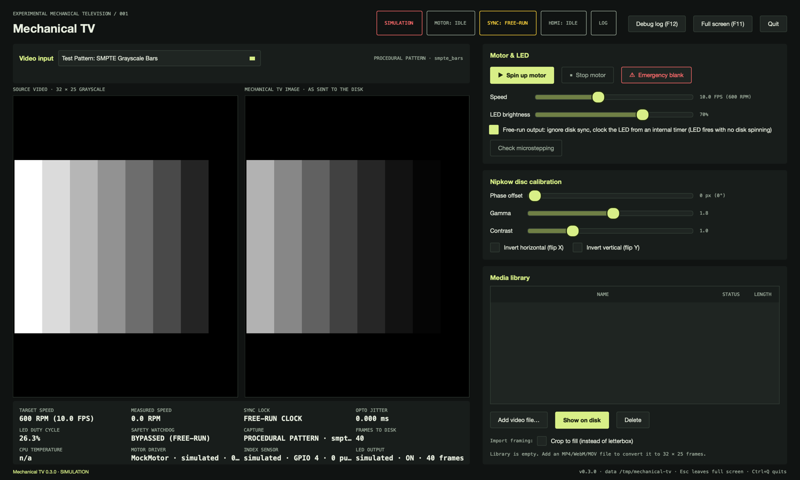

# The console (desktop application)

`mechanical-tv` is the operator console on the Pi's own display. It is a native Qt application that
drives the engine in-process: capture, frame pipeline, motor, index sensor, LED and media library.
There is no web interface, server, browser or login.



## Starting it

The installer adds a desktop icon, a menu entry (Sound & Video > Mechanical TV) and an autostart
entry, so the console opens full screen with the desktop. From a terminal:

```bash
/opt/mechanical-tv/current/bin/mechanical-tv --env-file /etc/mechanical-tv/environment              # window
/opt/mechanical-tv/current/bin/mechanical-tv --env-file /etc/mechanical-tv/environment --fullscreen
/opt/mechanical-tv/current/bin/mechanical-tv --mock-hardware                                         # simulation
/opt/mechanical-tv/current/bin/mechanical-tv --check                                                 # report, no window
```

| Option | Environment | Meaning |
| --- | --- | --- |
| `--env-file FILE` | | Read `MTV_*` defaults from a `KEY=value` file |
| `--data DIR` | `MTV_DATA` | Library and logs. Default `~/.local/share/mechanical-tv`; an unwritable directory falls back to it with a log line |
| `--fullscreen` | `MTV_FULLSCREEN=1` | Start full screen. F11 toggles, Esc leaves |
| `--default-source auto\|pattern\|hdmi` | `MTV_DEFAULT_SOURCE` | `auto` selects Live HDMI when the capture device exists (never in simulation) |
| `--free-run` | | Start with free-run output on |
| `--debug-window` | `MTV_DEBUG=1` | Open the debug log at start |
| `--mock-hardware` | `MTV_MOCK_HARDWARE=1` | Simulated motor, index sensor and LED |
| `--hdmi-device`, `--hdmi-bridge`, `--hdmi-format`, `--hdmi-edid`, `--hdmi-fit`, `--hdmi-backend` | `MTV_HDMI_*` | Capture settings (see INSTALL.md) |
| `--motor-port`, `--opto-pin`, `--led-pin`, `--spi-led` | `MTV_MOTOR_PORT`, `MTV_OPTO_PIN`, `MTV_LED_PIN`, `MTV_SPI_LED` | Pins and the SPI LED output |
| `--check` | | Print the environment report as JSON and exit (exit status 1 without FFmpeg) |
| `--screenshot FILE` | | Save the window as PNG after 4 s and quit (documentation) |
| `--version`, `--help` | | |

If real hardware fails to initialise (for example the PWM channel is missing), the console says so
in the footer and the log, and runs in simulation so the interface can still be used. The SIMULATION
pill is then red.

**Keys:**

| Key | Action |
| --- | --- |
| Space | Spin up or stop the motor (not while the input list or a slider has focus) |
| F11 | Toggle full screen |
| Esc | Leave full screen |
| F12 | Debug log |
| Ctrl+Q | Quit. Stops the motor and blanks the LED first; closing the window, logging out and `kill` do the same |

## Screen

- **Header pills:**
  - Hardware mode: REALTIME HARDWARE or SIMULATION.
  - Motor state: IDLE, RAMPING, RUNNING, LOCKED, TESTING, MOTOR TEST or STALLED.
  - Sync: LOCKED, UNLOCKED or FREE-RUN.
  - HDMI: LIVE, BLACK, NO SIGNAL or IDLE.
  - Log: `LOG: n ERRORS` turns red; click it for the debug window.
- **Video input:** Live HDMI, ten test patterns, or the selected library clip. The status line gives
  the adapter, backend, resolution and frame rate for HDMI, with the reason underneath when there is
  no picture.
- **Left picture:** the input as it arrives. For Live HDMI this is a 320 × 250 colour picture of the
  whole source (eyebrow `HDMI INPUT · LIVE PICTURE`); otherwise the 32 × 25 source frame. Both are
  drawn at whole-pixel zoom and repaint 25 times a second.
- **Right picture:** the 32 × 25 frame as sent to the disk, after gamma, contrast, brightness, phase
  offset and flips, mapped back from the pulse stream. When the motor is not running it shows the
  live source through the same transform.
- **Telemetry:**
  - Target and measured speed, sync lock, opto jitter, LED duty cycle and the safety watchdog.
  - Capture state, frames sent to the disk and CPU temperature.
  - The motor driver (with its microstep mode and speed), the index sensor backend and pulse count,
    and the LED backend and frame count.
- **Motor & LED:** Spin up, Stop, Emergency blank, Speed (1 to 24 FPS), LED brightness, Free-run
  output, and **Check microstepping**. Stop and Emergency blank act at once, even while another
  action (a microstep check, a source switch, an import) is still running.
- **Nipkow disc calibration:** phase offset (0 to 799 pixels, shown in degrees too), gamma,
  contrast, flip X and flip Y.
- **Media library:** add a video file from local storage, convert it in the background (only while
  the motor is stopped), show it on the disk, delete it. Crop to fill or letterbox.
- **Footer:** the latest notice or error, version and data directory.

**Sliders** apply when released, or immediately on keyboard, wheel or a click on the track. While
one is held, and for 1.5 s after, the refresh leaves it alone so the engine's value does not snap it
back.

## Free-run output

With no disk or no index sensor the LED never fires: frames are clocked by the index pulse and the
interlock blanks the LED when pulses stop. **Free-run output** replaces that clock with an internal
timer at the target speed. The LED shows 800 pixels per period and the preview updates, so the
interlock is bypassed. Index pulses, when present, still update the speed and lock readouts but do
not clock frames.

Use it to prove the video path (capture, scaling, gamma, LED driver) on the bench. Do not leave it
on with a printed disk stopped under the 3 W LED. Emergency blank, Ctrl+Q and closing the window
turn it off; stopping the motor does not.

## Motor settings

**Microsteps** (Motor & LED panel) selects the driver's microstep mode: 1/1 to 1/64, shown with
the steps per revolution the motor is then commanded (200 x the mode). It must match the MS
jumpers on the driver; change it with the motor stopped, then press **Check microstepping** to
confirm. **Spin-up ramp** sets the acceleration after the coils energise, in FPS gained per second
(0.1-10; `MTV_RAMP_RATE` allows up to 50). Lower it if a heavy disk slips or stalls while spinning
up. Both are saved in the data directory's `settings.json` and override `MTV_MICROSTEPS` and
`MTV_RAMP_RATE` on the next start.

## Check microstepping

With the motor stopped and free-run off, **Check microstepping** turns the disk at 0.25 rev/s, as
configured, for up to 40 s. It counts motor steps between two debounced index pulses and reports
the result:

- `Microstep check passed: 3200 steps per revolution measured (1/16)` when the jumpers match.
- Otherwise, the measured mode and what to change (the MS pins or the **Microsteps** selector).
- `Microstep check FAILED: the index sensor on GPIO 4 pulsed ... while the motor made only N steps`
  when pulses arrive with fewer than 100 motor steps between them. No stepping mode does that: the
  sensor line is pulsing on its own (noise from the motor or driver leads, a loose signal, supply or
  ground wire, or the notch parked at the edge of the sensor slot).

If the driver is really at full step, the disk turns 16 times faster than intended during the check,
at 4 rev/s, and may stall. A stall shows as "index pulse(s)" missing, so measure the MS pins as well.
Stop and Emergency blank cancel the check.

## When the sensor and the motor disagree

The motor runs on its own clock and keeps turning whatever the index sensor sees. The sensor only
places each revolution of the picture: the notch marks where a revolution starts, and the motor's
speed (including the spin-up ramp) gives how long it lasts. The LED is lit only while the notch
arrives every revolution's worth of motor steps.

- **No index pulse** for a second (or 3 revolutions) while the motor turns above 0.3 rev/s: the
  footer says so, SYNC LOCK reads NO NOTCH (LED OFF), and the LED stays dark. It clears by itself
  when the notch is seen again.
- **Wrong steps per revolution** (more than 8 % off for 3 revolutions): the footer names the likely
  microstep mode or a slipping rotor, SYNC LOCK reads SLIPPING (SENSOR-TIMED), and the LED is
  timed from the notch-to-notch period until the disk follows the motor again.
- **Edges fewer than 100 motor steps apart** are bounce, noise, or the notch edge parked in the beam
  and shaken across the threshold when the coils energise. They are counted as rejected and ignored.

`MTV_STALL_STOP=1` restores the old behaviour of stopping the motor (pill STALLED) on these. See
[DIAGNOSIS.md](DIAGNOSIS.md) for the bench checklist.

## Tests tab

The second tab runs each part of the machine on its own.

- **Motor only** spins the motor at the chosen speed with the LED locked off and no stall checks.
  It shows the commanded speed and the microstep setting. Space starts and stops it while the tab
  is shown.
- **LED only** lights the LED steady or blinking once a second at a chosen level, with the motor
  stopped or in the motor-only test. It switches itself off after 30 s.
- **Index sensor** shows the line level (HIGH or LOW), edge counts, a 5 s timeline of edges (tall
  green for an accepted notch, short red for a rejected one), the last edges with the time and
  motor steps since the edge before, and each revolution between accepted notches with its steps
  against the expected count. Tick *Watch the sensor* to read it with the motor stopped and turn
  the disk by hand: each pass of the notch should add one green mark. A burst of red marks means a
  flickering output.

## Debug log

F12 (or the LOG pill, or **Debug log (F12)**) opens a separate window with every engine message,
operator action and error. Errors are red and warnings yellow, with an **Errors only** filter, a
**Mark** button that stamps a line so a test can be found later, and **Clear view**. The same lines
go to `~/.local/share/mechanical-tv/logs/mechanical-tv.log` (1 MB × 5).

## Hardware access

The console runs as the desktop user, which the installer adds to `gpio`, `i2c`, `video` and `spi`
and gives a realtime priority limit. Log out and in once after the first install. At start the log
has a line `realtime LED thread: SCHED_FIFO 60, CPU 3, isolated CPUs: 3, LED …, index gpio-cdev`.
If the priority was refused, a warning says why and how to fix it.